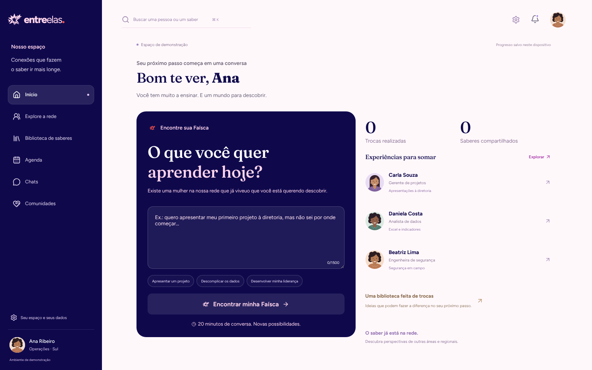
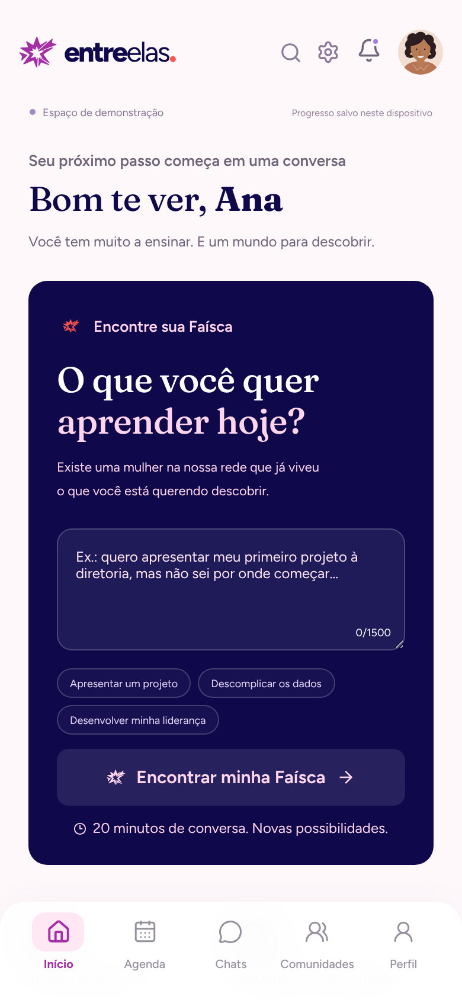
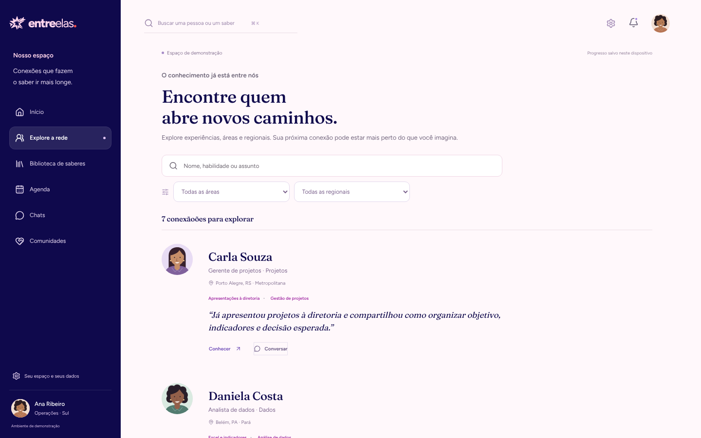

# Entre Elas

### O conhecimento das mulheres da Equatorial, visível e em circulação.

Entre Elas conecta quem quer aprender com quem já viveu aquilo, por meio de uma conversa curta e com propósito: a **Faísca**. Cada Faísca deixa um saber reconhecido e, com autorização das duas participantes, uma dica para toda a rede. Assim a empresa passa a enxergar um mapa vivo de quem sabe o quê.

[**Acessar o piloto**](https://entre-elas-omega.vercel.app/entrar) · [Explorar sem cadastro](https://entre-elas-omega.vercel.app/demonstracao) · [Roteiro da demonstração](docs/roteiro-demo.md) · [Caminho para produção](docs/caminho-producao.md)

<p>
  
  
</p>

## O problema

Em uma empresa distribuída por vários estados, como a Equatorial, a experiência que resolveria o desafio de uma colaboradora muitas vezes está com outra, em outra regional ou em outra área. As duas não se conhecem e não sabem que poderiam se ajudar.

O custo aparece de várias formas:

- **Conhecimento invisível:** o que se aprende na prática, em campo, em projetos e em situações difíceis, não está em nenhum cadastro.
- **Conhecimento concentrado:** quando só uma pessoa domina um assunto, ele se perde se ela muda de área ou sai da empresa.
- **Redes desiguais:** quem já tem contatos encontra apoio; quem está em uma regional distante ou em uma função de campo, nem sempre.
- **Mentoria que não escala:** programas formais alcançam poucas pessoas e dependem de agendas longas.

## A solução: a Faísca

```
pedido em linguagem do dia a dia (é a primeira pergunta do cadastro)
   → a IA indica até 3 colegas e mostra a evidência de cada indicação
   → convite para 20 minutos de conversa (chat e vídeo)
   → cada uma registra o que aprendeu
   → com autorização das duas, o aprendizado vira dica para a rede
   → o saber reconhecido melhora as próximas indicações
```

O que a torna diferente de uma rede social interna:

1. **Começa por uma necessidade real**, não por um feed.
2. **Toda indicação se explica**: a participante vê o trecho do perfil ou da troca que levou à sugestão. A IA não decide por ninguém, e sempre existe a alternativa de escolher manualmente.
3. **O resultado é um mapa de saberes confirmado por trocas reais**, não uma lista de competências autodeclaradas.
4. **Consentimento em cada etapa**: o uso de IA é opcional e explicado, e uma dica só é publicada quando as duas autorizam.
5. **Protege quem ajuda**: cada pessoa define quantas Faíscas topa receber por mês ("Abro Faíscas"). Quando as vagas acabam, a curadoria indica outras pessoas, e a demanda se distribui pela rede.



## Valor para a Equatorial

O painel de liderança, restrito e sempre com dados agregados, responde perguntas que hoje não têm resposta:

| Pergunta | Indicador no painel |
|---|---|
| As pessoas estão se ajudando? | Convites, taxa de aceite e Faíscas realizadas |
| A rede quebra silos? | % de conexões entre regionais e entre áreas diferentes |
| As trocas foram úteis? | Utilidade média (1–5) e % que faria outra Faísca |
| Onde falta conhecimento? | Temas procurados que ninguém oferece |
| Onde há risco de perda? | Saberes que só uma pessoa tem |
| O conhecimento circula? | Dicas publicadas e saberes reconhecidos |

Esses dados indicam onde investir em formação, quem convidar para ensinar e que conhecimento proteger.

## Piloto real com a banca (18 a 23 de outubro de 2026)

Em vez de só uma demonstração, o Entre Elas está em uso real: cadastro aberto, login verificado, convites, chat, vídeo e registro de aprendizados entre as participantes. Os números abaixo vêm do painel de liderança, que exclui dados de teste e de demonstração.

<!-- Atualizar com o botão "Copiar resumo para a apresentação" do painel de liderança. -->
| Indicador | Resultado |
|---|---|
| Participantes | a apurar no fim do piloto |
| Faíscas realizadas | a apurar no fim do piloto |
| Conexões entre regionais diferentes | a apurar no fim do piloto |
| Utilidade média | a apurar no fim do piloto |

## Como a IA trabalha

- **Interpretar o pedido:** transforma o texto livre em 2 ou 3 saberes necessários.
- **Buscar:** compara esses saberes com o mapa de saberes por similaridade semântica (pgvector) e exclui a própria solicitante.
- **Ranquear:** escolhe até 3 pessoas, favorece diversidade de áreas e regionais e cita a evidência literal de cada indicação.
- **Preparar e resumir:** gera 3 perguntas de pauta antes da conversa e, depois, um resumo baseado nas anotações das duas, com os trechos usados à vista.

Os prompts fazem uma tarefa por vez, respondem em JSON validado e são proibidos de inventar evidências. Se a IA falhar ou demorar mais que o limite, a participante continua pelo caminho manual.

## Privacidade e cuidado

- A IA só recebe textos de quem autorizou, depois de um aviso que nomeia os provedores.
- Mensagens de chat não alimentam o mapa de saberes.
- Conteúdo de comunidade privada não gera sugestões para quem não é membro.
- A liderança vê apenas números agregados; objetivos individuais nunca aparecem no painel.

O piloto usa provedores de IA em plano gratuito, adequado só para um teste curto com aviso explícito. Para uso corporativo, o plano está em [Caminho para produção](docs/caminho-producao.md).

## Tecnologia

Next.js 16 e React 19 (TypeScript estrito), Supabase (Postgres, pgvector, autenticação), Gemini com Groq como alternativa automática, Daily para vídeo, Zod nos contratos, Vitest e Playwright nos testes, implantação na Vercel. O app é instalável no celular (PWA).

## Documentação

- [Roteiro da demonstração](docs/roteiro-demo.md)
- [Caminho para produção: privacidade, escala e custo](docs/caminho-producao.md)
- [Visão do produto](docs/mvp.md)
- [Piloto de avaliação](docs/piloto-banca.md)
- [Identidade visual](docs/identidade-visual.md)
- [Princípios do produto](docs/principios.md)

---

**Entre Elas: uma Faísca pode transformar experiência em oportunidade.**
